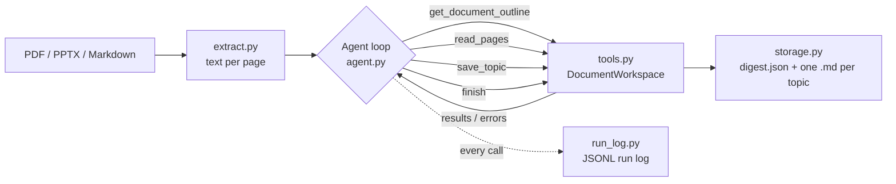

# Retrieve

An AI agent that reads your course slides, PDFs and notes, distills them into
one-concept-per-note study topics, and (in later phases) quizzes you on the
ones you're forgetting.

> **Status:** Phase 1 of 5. The distillation agent works from the command line.
> The review loop, database and web app are on the [roadmap](#roadmap).

## Why

Knowing something and being able to explain it precisely in an interview are
two different skills. After months of courses, the knowledge is there, but the
exact wording and the order of steps fade. Retrieve turns course material into
short, structured notes you can review quickly. The goal is an agent that
tracks what you remember and brings back what you don't.

## How it works



The agent loop is written by hand against the Claude API, with no agent
framework, so every step is visible:

1. Claude receives the task and four tool definitions.
2. It decides what to do: look at the outline, read a page range, save a topic, or finish.
3. The code runs the tool and sends the result back. **Mistakes come back as
   errors the model can fix**: a bad page range, a malformed topic, a
   duplicate title, or trying to finish before every page has been read.
4. The loop ends when `finish` succeeds or the turn limit is reached.

Every topic is validated with Pydantic before it's saved, and every model call
and tool call is logged with token counts and an estimated cost.

## Quick start

Requires Python 3.10+ and an [Anthropic API key](https://platform.claude.com).

```bash
git clone https://github.com/<your-username>/retrieve.git
cd retrieve

# Using uv (recommended)
uv venv --python 3.12
source .venv/bin/activate          # Windows: .venv\Scripts\Activate.ps1
uv pip install -r requirements-dev.txt

# Or using plain pip
python3 -m venv .venv
source .venv/bin/activate
pip install -r requirements-dev.txt

cp .env.example .env               # then paste your API key into .env
```

## Usage

```bash
# Try the included example notes
python -m retrieve summarize examples/tcp-basics.md --course "Networking"

# Your own material (keep it in materials/, which git ignores)
python -m retrieve summarize materials/week-3-slides.pdf --course "Networking"

# Use a cheaper model for simple slides
python -m retrieve summarize materials/week-3-slides.pdf --model claude-haiku-4-5
```

The command prints each topic, then a run summary with turns, tool calls,
corrected errors and estimated cost. Output is written to:

```
knowledge/week-3-slides/
├── digest.json                  # all topics, for code to load later
├── tcp-three-way-handshake.md   # one note per concept
└── ...
logs/20260916-021500-week-3-slides.jsonl
```

Each note has YAML frontmatter (source, pages, difficulty, tags, course), so
the `knowledge/` folder also opens directly as an Obsidian vault.

## Project structure

```
retrieve/
├── agent.py       # the agent loop and system prompt
├── tools.py       # tool definitions and what each tool does
├── schema.py      # Pydantic models for topics and digests
├── extract.py     # PDF / PPTX / Markdown -> text per page
├── storage.py     # writes digest.json and Markdown notes
├── run_log.py     # JSONL logging, token and cost tracking
├── config.py      # settings from .env
└── cli.py         # command-line interface
tests/             # 26 tests, runnable offline without an API key
examples/          # sample notes to try the agent on
```

## Testing

```bash
pytest
```

The tests never call the real API. A fake client replays scripted responses
to test the loop's logic, including error recovery and nudging. A separate
test runs the loop through the real Anthropic SDK against a mocked HTTP server,
checking that the requests are valid.

## Design decisions

- **A hand-written loop instead of a framework.** The loop is short and fully
  explainable, and the project exists to demonstrate agent design.
- **Tools that return fixable errors.** Validation happens in the tools, and
  errors go back to the model instead of crashing the run. The agent corrects
  itself, and the log counts how often that happens.
- **Chunked reading.** `read_pages` is capped at 8 pages per call, so the
  agent summarises as it goes instead of loading a whole textbook at once.
- **A completion check.** `finish` refuses to succeed until every page with
  text has been read, so the agent can't silently skip material.
- **Plain files first.** Phase 1 stores JSON and Markdown. A database arrives
  when the review loop needs to query rating history.

## Roadmap

- [x] **Phase 1:** distillation agent (CLI), structured topics, run logging, tests
- [ ] **Phase 2:** Postgres + pgvector storage (Neon), de-duplication across sources
- [ ] **Phase 3:** review screen: read a topic, rate it *solid / shaky / forgotten*
- [ ] **Phase 4:** the review policy: ratings decide what gets resurfaced and when
- [ ] **Phase 5:** Q&A over your own notes (RAG), generated practice questions,
      interview-story practice from project write-ups
- [ ] Evaluation set: hand-labelled slides to measure tagging accuracy

## Known limitations

- Scanned PDFs with no text layer need OCR first.
- The whole conversation is resent on every turn, so very long documents use
  more tokens. Compressing earlier turns is a planned improvement.
- Cost estimates use a hard-coded price table in `run_log.py`.

## Acknowledgements

The note structure (one concept per note, metadata in frontmatter, distill
before saving, keep an agent log) was inspired by the *Knowledge Agent
Workshop* run by Make AI Practical in Melbourne. This project is an
independent implementation.
