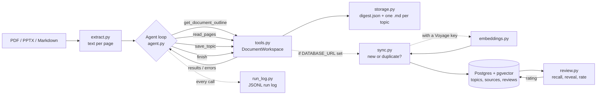

# Retrieve

An AI agent that reads your course slides, PDFs and notes, distills them into
one-concept-per-note study topics, and (in later phases) quizzes you on the
ones you're forgetting.

> **Status:** Phase 3 of 5. Distill course material from the command line,
> store topics in Postgres, and review them with recall-then-reveal ratings.
> The smarter review policy and web app are on the [roadmap](#roadmap).

## Why

Knowing something and being able to explain it precisely in an interview are
two different skills. After months of courses, the knowledge is there, but the
exact wording and the order of steps fade. Retrieve turns course material into
short, structured notes you can review quickly. The goal is an agent that
tracks what you remember and brings back what you don't.

## How it works



The agent loop is written by hand against the Claude API, with no agent
framework, so every step is visible:

1. Claude receives the task and four tool definitions.
2. It decides what to do: look at the outline, read a page range, save a topic, or finish.
3. The code runs the tool and sends the result back. **Mistakes come back as
   errors the model can fix**: a bad page range, a malformed topic, a
   duplicate title, or trying to finish before every page has been read.
4. The loop ends when `finish` succeeds or the turn limit is reached.

Every topic is validated with Pydantic before it's saved, and every model call
and tool call is logged with token counts and an estimated cost.

## Quick start

Requires Python 3.10+ and an [Anthropic API key](https://platform.claude.com).

```bash
git clone https://github.com/<your-username>/retrieve.git
cd retrieve

# Using uv (recommended)
uv venv --python 3.12
source .venv/bin/activate          # Windows: .venv\Scripts\Activate.ps1
uv pip install -r requirements-dev.txt

# Or using plain pip
python3 -m venv .venv
source .venv/bin/activate
pip install -r requirements-dev.txt

cp .env.example .env               # then paste your API key into .env
```

## Usage

```bash
# Try the included example notes
python -m retrieve summarize examples/tcp-basics.md --course "Networking"

# Your own material (keep it in materials/, which git ignores)
python -m retrieve summarize materials/week-3-slides.pdf --course "Networking"

# Use a cheaper model for simple slides
python -m retrieve summarize materials/week-3-slides.pdf --model claude-haiku-4-5
```

The command prints each topic, then a run summary with turns, tool calls,
corrected errors and estimated cost. Output is written to:

```
knowledge/week-3-slides/
├── digest.json                  # all topics, for code to load later
├── tcp-three-way-handshake.md   # one note per concept
└── ...
logs/20260916-021500-week-3-slides.jsonl
```

Each note has YAML frontmatter (source, pages, difficulty, tags, course), so
the `knowledge/` folder also opens directly as an Obsidian vault.

## The database (Phases 2 and 3)

Set `DATABASE_URL` in `.env` (a free [Neon](https://neon.tech) Postgres
project works; so does a local Postgres with the pgvector extension), then
create the schema once:

```bash
python -m retrieve init-db
```

From then on, every `summarize` run also stores its topics in the database,
and any digests you produced *before* setting this up can be backfilled:

```bash
python -m retrieve import-knowledge
```

### Reviewing (Phase 3)

```bash
python -m retrieve review                      # everything, 20 topics max
python -m retrieve review --course Networking --limit 10
```

Each topic shows its **title first**. You try to explain the concept to
yourself, then press Enter to reveal the summary and key points, then rate
how it went: `s` solid, `h` shaky, `f` forgotten (`k` skips, `q` quits).

```
[1/2] TCP three-way handshake
    core | Networking | from week-1.pdf | not reviewed yet
Explain it to yourself, then press Enter to reveal (q to quit):

TCP opens a connection with SYN, SYN-ACK, ACK before any data is sent.
  - SYN
  - SYN-ACK
  - ACK

How did you do? [s/h/f, k=skip, q=quit]: f
```

Every rating is stored, so the queue changes: topics you've never seen come
first, then ones you marked forgotten, then shaky, then solid, least
recently reviewed first within each group. That's a deliberately simple
rule for Phase 3; Phase 4 replaces it with a policy that uses the whole
rating history to decide *when* a topic should come back.

### De-duplication across sources (Phase 2, needs a Voyage key)

Add `VOYAGE_API_KEY` (from [Voyage AI](https://dashboard.voyageai.com),
Anthropic's recommended embeddings partner -- Claude itself doesn't serve
embeddings) and each topic is also embedded and checked against everything
already saved, by meaning rather than by title text. The default model,
`voyage-4-lite`, includes 200M free tokens a month, which this project's
notes won't come close to using -- so in practice, embeddings cost nothing:

```
Synced to database: 3 new, 1 merged with existing topics
  - 'The TCP handshake' merged into 'TCP three-way handshake' (distance 0.041, now in 2 source(s))
```

A near-duplicate isn't inserted as a second row. Instead the existing topic
gains a link to the new source (and its page numbers) and its tags are
unioned with the new ones, so the same concept taught across different
weeks' slides converges on one topic instead of splitting into near-copies.
"Near" is a cosine-distance threshold (`RETRIEVE_DEDUP_THRESHOLD`, default
`0.10`) found by checking real reworded duplicates against genuinely
different topics from the same course; lower it if your material tends to
already be phrased close together.

Without a Voyage key, topics are stored with no vector and matching falls
back to exact title, which is enough to stop a re-run of the same file from
doubling everything but won't catch the same idea worded differently. You
can add the key later; only topics stored after that will have embeddings.

File output from Phase 1 is unaffected -- `knowledge/` is written the same
way whether or not `DATABASE_URL` is set. Pass `--no-db` to skip syncing
for one run without touching `.env`.

## Project structure

```
retrieve/
├── agent.py       # the agent loop and system prompt
├── tools.py       # tool definitions and what each tool does
├── schema.py      # Pydantic models for topics and digests
├── extract.py     # PDF / PPTX / Markdown -> text per page
├── storage.py     # writes digest.json and Markdown notes
├── run_log.py     # JSONL logging, token and cost tracking
├── embeddings.py  # topic -> vector, via Voyage AI
├── db.py          # Repository: Postgres/pgvector reads and writes
├── sync.py        # the de-duplication decision (new vs. merge)
├── review.py      # queue order + the recall/reveal/rate session
├── config.py      # settings from .env
└── cli.py         # command-line interface
migrations/        # SQL schema, applied by `python -m retrieve init-db`
tests/             # 59 tests; all but the Postgres integration tests run
                    # fully offline, without an API key
examples/          # sample notes to try the agent on
```

## Testing

```bash
pytest
```

The tests never call a real paid API. A fake client replays scripted
responses to test the loop's logic, including error recovery and nudging. A
separate test runs the loop through the real Anthropic SDK against a mocked
HTTP server, checking that the requests are valid.

The de-duplication decision in `sync.py` is tested the same way, against a
fake in-memory repository and a fake embedding client (`tests/test_sync.py`),
so the "is this the same topic?" logic is checked with no database or Voyage
key needed. Separately, `tests/test_db_integration.py` runs `db.py`'s actual
SQL -- cosine-distance ordering, the source-merge upsert, tag unioning --
against a real local Postgres with pgvector, because that's the layer a fake
can't safely stand in for. It skips cleanly if no test database is reachable;
locally that's:

```bash
createdb retrieve_test
psql retrieve_test -c 'CREATE EXTENSION IF NOT EXISTS vector;'
```

## Design decisions

- **A hand-written loop instead of a framework.** The loop is short and fully
  explainable, and the project exists to demonstrate agent design.
- **Tools that return fixable errors.** Validation happens in the tools, and
  errors go back to the model instead of crashing the run. The agent corrects
  itself, and the log counts how often that happens.
- **Chunked reading.** `read_pages` is capped at 8 pages per call, so the
  agent summarises as it goes instead of loading a whole textbook at once.
- **A completion check.** `finish` refuses to succeed until every page with
  text has been read, so the agent can't silently skip material.
- **Plain files first, database additive.** Phase 1 stores JSON and
  Markdown, and Phase 2 doesn't replace that -- it adds Postgres alongside
  it. `knowledge/` stays a readable, portable Obsidian vault regardless of
  whether `DATABASE_URL` is set; the database exists for what files can't
  do well, like vector search and rating history.
- **Title before answer.** The review screen makes you attempt recall
  before it shows the summary, because reading an answer and recognising it
  is a different (weaker) skill from producing it. The rating is of the
  attempt, not of whether the note looked familiar.
- **The queue policy is one swappable function.** `order_for_review` is
  simple in Phase 3 and isolated so Phase 4 can replace it with a
  history-aware policy without touching the session or the SQL.
- **De-duplicate by meaning, not by title string.** Course material repeats
  itself across weeks with different wording ("the TCP handshake" vs. "TCP's
  three-way handshake"). Matching on embeddings catches that; matching on
  exact or fuzzy title text wouldn't.
- **The dedup decision is a separate, fake-testable module.** `sync.py`
  only depends on two small protocols (an embedder, a repository), so the
  question "should this be a new topic or a merge?" is tested without a
  database. `db.py`'s SQL is verified separately, against a real Postgres,
  because a hand-rolled cosine-distance calculation in a fake wouldn't prove
  the actual `<=>` query and index behave correctly.

## Roadmap

- [x] **Phase 1:** distillation agent (CLI), structured topics, run logging, tests
- [x] **Phase 2:** Postgres + pgvector storage (Neon), de-duplication across sources
- [x] **Phase 3:** terminal review: recall from the title, reveal, rate it *solid / shaky / forgotten*
- [ ] **Phase 4:** the review policy: ratings decide what gets resurfaced and when
- [ ] **Phase 5:** Q&A over your own notes (RAG), generated practice questions,
      interview-story practice from project write-ups
- [ ] Evaluation set: hand-labelled slides to measure tagging accuracy

## Known limitations

- Scanned PDFs with no text layer need OCR first.
- The whole conversation is resent on every turn, so very long documents use
  more tokens. Compressing earlier turns is a planned improvement.
- Cost estimates use a hard-coded price table in `run_log.py`.

## Acknowledgements

The note structure (one concept per note, metadata in frontmatter, distill
before saving, keep an agent log) was inspired by the *Knowledge Agent
Workshop* run by Make AI Practical in Melbourne. This project is an
independent implementation.
