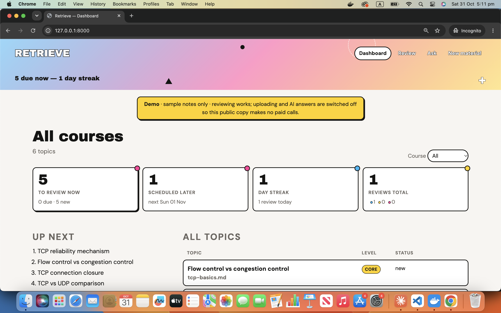
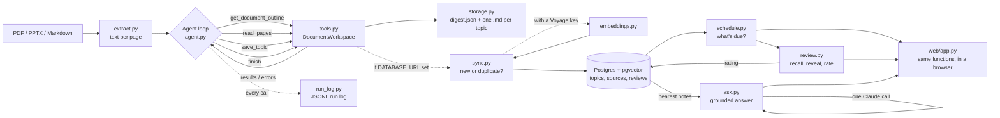

# Retrieve

An AI agent that reads your course slides, PDFs and notes, distills them into
one-concept-per-note study topics, and (in later phases) quizzes you on the
ones you're forgetting.



> **Status:** Phase 5 in progress. Distill course material from the command
> line, store topics in Postgres, review them on a spaced-repetition schedule
> driven by your own ratings, and ask questions answered from your notes
> alone -- in the terminal or in a local web app. Practice questions are
> next on the [roadmap](#roadmap).

## Why

Knowing something and being able to explain it precisely in an interview are
two different skills. After months of courses, the knowledge is there, but the
exact wording and the order of steps fade. Retrieve turns course material into
short, structured notes you can review quickly. The goal is an agent that
tracks what you remember and brings back what you don't.

## How it works



The agent loop is written by hand against the Claude API, with no agent
framework, so every step is visible (there is also a second driver for the
same tools, `sdk_agent.py`, that lets the run come out of a Claude
subscription instead of an API key -- see
[Subscription or API key?](#subscription-or-api-key)):

1. Claude receives the task and four tool definitions.
2. It decides what to do: look at the outline, read a page range, save a topic, or finish.
3. The code runs the tool and sends the result back. **Mistakes come back as
   errors the model can fix**: a bad page range, a malformed topic, a
   duplicate title, or trying to finish before every page has been read.
4. The loop ends when `finish` succeeds or the turn limit is reached.

Every topic is validated with Pydantic before it's saved, and every model call
and tool call is logged with token counts and an estimated cost.

## Quick start

Requires Python 3.10+ and one way to reach Claude -- see
[Subscription or API key?](#subscription-or-api-key) below. The short
version: a Claude Pro/Max subscription is enough, and an
[Anthropic API key](https://platform.claude.com) is the optional backup.

```bash
git clone https://github.com/<your-username>/retrieve.git
cd retrieve

# Using uv (recommended)
uv venv --python 3.12
source .venv/bin/activate          # Windows: .venv\Scripts\Activate.ps1
uv pip install -r requirements-dev.txt

# Or using plain pip
python3 -m venv .venv
source .venv/bin/activate
pip install -r requirements-dev.txt

cp .env.example .env               # then follow the comments in .env
```

### Run with Docker

The quickest way to try Retrieve, with nothing to install but
[Docker](https://www.docker.com/products/docker-desktop/). Docker Compose
starts the web app and a Postgres database with pgvector, in
[demo mode](#demo-mode-for-a-public-copy): sample notes, no API keys,
and no paid calls.

```bash
git clone https://github.com/Coral-ctrl/retrieve.git
cd retrieve

# Build the image and start the app and database in the background
docker compose up -d --build

# Create the tables, then load the sample TCP notes
docker compose run --rm app python -m retrieve init-db
docker compose run --rm -e RETRIEVE_KNOWLEDGE_DIR=demo-data app python -m retrieve import-knowledge
```

Then open http://localhost:8000. The dashboard, review and search all
work; uploading and AI answers are switched off in demo mode.

```bash
docker compose down      # stop (the database is kept for next time)
docker compose down -v   # stop and delete the database
```

The image runs as a non-root user, and `.env` is excluded by
`.dockerignore`, so no keys or personal notes end up inside it.

### Subscription or API key?

`summarize` and `ask` need Claude. There are two ways to pay for that, and
`RETRIEVE_BACKEND` in `.env` picks one:

| `RETRIEVE_BACKEND`       | How it runs                                                                                                                                                                                | What it costs                                                         |
| ------------------------ | ------------------------------------------------------------------------------------------------------------------------------------------------------------------------------------------ | --------------------------------------------------------------------- |
| `subscription` (default) | The agent's tools are driven by the [Claude Agent SDK](https://support.claude.com/en/articles/15036540-use-the-claude-agent-sdk-with-your-claude-plan), signed in with your Claude account | Comes out of your Pro/Max plan's monthly credit; nothing extra to buy |
| `api`                    | Phase 1's hand-written loop on the Anthropic API                                                                                                                                           | Pay per token on an API key                                           |

**To use the subscription** (the default), sign in once:

```bash
python -m retrieve setup-token     # opens a browser to sign in; prints a token
```

Put the token in `.env` as `CLAUDE_CODE_OAUTH_TOKEN=...`. That's it: the
`claude-agent-sdk` package in `requirements.txt` bundles the Claude Code
binary, so there is nothing else to install (no Node). If you've already
signed in to Claude Code on this machine, you can skip the token and it
uses that sign-in.

**The API key is the backup.** With both configured, Retrieve uses the
subscription and only falls back to the key -- printing a notice, because
that is when metered billing starts -- if the subscription path can't run:
the SDK isn't installed, you're not signed in, or your plan's usage limit
for the period is hit. Nothing is saved until a run succeeds, so the retry
is safe.

Anthropic licenses the subscription route for individual use, which is
exactly what this is: your own notes, on your own machine. A deployment
other people use would need the API backend.

## Usage

```bash
# Try the included example notes
python -m retrieve summarize examples/tcp-basics.md --course "Networking"

# Your own material (keep it in materials/, which git ignores)
python -m retrieve summarize materials/week-3-slides.pdf --course "Networking"

# Use a cheaper model for simple slides
python -m retrieve summarize materials/week-3-slides.pdf --model claude-haiku-4-5
```

The command prints each topic, then a run summary with turns, tool calls,
corrected errors and estimated cost (on the subscription backend the cost
is shown at API rates for comparison; you aren't billed it). Output is
written to:

```
knowledge/week-3-slides/
├── digest.json                  # all topics, for code to load later
├── tcp-three-way-handshake.md   # one note per concept
└── ...
logs/20260916-021500-week-3-slides.jsonl
```

Each note has YAML frontmatter (source, pages, difficulty, tags, course), so
the `knowledge/` folder also opens directly as an Obsidian vault.

## The database (Phases 2 to 4)

Set `DATABASE_URL` in `.env` (a free [Neon](https://neon.tech) Postgres
project works; so does a local Postgres with the pgvector extension), then
create the schema once:

```bash
python -m retrieve init-db
```

From then on, every `summarize` run also stores its topics in the database,
and any digests you produced _before_ setting this up can be backfilled:

```bash
python -m retrieve import-knowledge
```

### Reviewing (Phases 3 and 4)

```bash
python -m retrieve review                      # what's due today, 20 topics max
python -m retrieve review --course Networking --limit 10
python -m retrieve review --all                # everything, soonest due first (cramming)
python -m retrieve stats                       # what's due, what's new, streak
```

Each topic shows its **title first**. You try to explain the concept to
yourself, then press Enter to reveal the summary and key points, then rate
how it went: `s` solid, `h` shaky, `f` forgotten (`k` skips, `q` quits).

```
[1/2] TCP three-way handshake
    core | Networking | from week-1.pdf | overdue by 2 days (last: shaky)
Explain it to yourself, then press Enter to reveal (q to quit):

TCP opens a connection with SYN, SYN-ACK, ACK before any data is sent.
  - SYN
  - SYN-ACK
  - ACK

How did you do? [s/h/f, k=skip, q=quit]: s
-> solid. Back in 3 days.
```

**When a topic comes back is decided by spaced repetition** (`schedule.py`,
an adaptation of the SM-2 algorithm behind Anki): each time you rate a
topic _solid_ the gap before its next review grows -- 1 day, 3 days, then
multiplied by a per-topic _ease_ factor -- so well-known material fades
into the background. _Shaky_ repeats the current gap and lowers ease a
little; _forgotten_ drops the gap back to 1 day and lowers ease more. The
`review` queue shows what's due (most overdue first), then new topics --
the same order Anki uses, because a fading memory is more urgent than a
fresh one.

The schedule isn't stored anywhere. It's replayed from the append-only
`reviews` log each time, so there are no extra columns to keep in sync and
changing the rules later re-schedules everything consistently.

`stats` shows where things stand:

```
Networking: 24 topic(s)
  due now: 4   new: 2   scheduled later: 18
  last rating: 15 solid, 5 shaky, 2 forgotten
  reviews: 61 total, 4 today; streak 6 days
```

### In the browser

```bash
python -m retrieve serve            # opens http://127.0.0.1:8000
```

The same three things -- dashboard, review, ask -- as pages. The dashboard
shows what's due, what's new, your streak and every topic's status; the
review page shows the title, reveals on click (or Enter), and rates with
buttons or the same `s` / `h` / `f` keys as the terminal, previewing what
each rating would do; the ask page shows the answer with its sources.

It's a FastAPI app with server-rendered templates and a few lines of plain
JavaScript -- no framework, no build step, nothing to install beyond
`requirements.txt`. Every route is a thin adapter over the functions the
CLI already uses, so there is no study logic in the web layer and the two
interfaces can't drift apart. It runs on localhost for one person, so
there's no login. The terminal commands keep working alongside it.

#### Demo mode (for a public copy)

Retrieve is built for one person on localhost, so a copy on the public
internet needs different rules: no login, but also no way for a visitor to
spend money or see private notes. Rather than bolting on accounts, demo mode
removes what makes a public copy risky:

```bash
# on the server, with DATABASE_URL pointing at a separate demo database
RETRIEVE_DEMO_MODE=true python -m retrieve serve --host 0.0.0.0 --no-browser
```

- **No paid calls.** `serve` builds no Claude or Voyage client, and
  `create_app` drops any it's given, so no route has anything to call --
  enforced in one place rather than checked page by page.
- **Ask still works, minus the answer.** It runs the same retrieval step
  (Postgres keyword search, which is free) and shows the matching notes in
  place of Claude's answer.
- **New material is off.** Uploads are refused with a 403 before the file
  is read.
- **Separate data.** Point `DATABASE_URL` at a demo database (a Neon
  branch works well) and fill it with sample notes only. Your real notes
  stay where they are. From your own machine, without re-summarizing:

  ```bash
  mkdir -p demo-knowledge && cp -r knowledge/tcp-basics demo-knowledge/
  export DATABASE_URL="<demo database connection string>"
  python -m retrieve init-db
  RETRIEVE_KNOWLEDGE_DIR=demo-knowledge python -m retrieve import-knowledge
  ```

  Variables set in the shell win over `.env`, so in that terminal these
  commands use the demo database, not your everyday one. Open a new
  terminal afterwards to get back to normal.

A banner on every page tells visitors what they're looking at.

### Asking questions (Phase 5)

```bash
python -m retrieve ask "how does slow start work?"
python -m retrieve ask "what's the difference between flow and congestion control?" --course Networking
```

Retrieval-augmented generation over your own notes, in its simplest honest
form. The question is embedded (Voyage's `query` input type, the partner of
the `document` type the notes were stored with) and the nearest topics are
pulled from the same pgvector index de-duplication uses. Those notes go to
Claude with one firm rule: **answer only from these notes, cite them, and
say plainly if they don't cover the question.**

```
Found 2 relevant note(s) by meaning:
  [1] Flow control vs congestion control  distance 0.31
  [2] TCP reliability mechanism  distance 0.47

Slow start is part of congestion control: TCP starts slowly and backs off
when it detects packet loss [1]. Your notes don't go into how the window
grows during slow start.

Sources:
  [1] week-3-slides.pdf p.5
  [2] week-3-slides.pdf p.4

812 input / 61 output tokens, ~US$0.0014
```

That last sentence is the point. A general assistant would happily explain
slow start's window doubling from its own knowledge; `ask` tells you your
notes are thin there, which is what you need to know before an interview.
Each question costs one Claude call (a cent or so) and, with a Voyage key,
one embedding request. Without a Voyage key it falls back to Postgres
full-text search, which finds notes that share words with the question but
not ones phrased differently.

### De-duplication across sources (Phase 2, needs a Voyage key)

Add `VOYAGE_API_KEY` (from [Voyage AI](https://dashboard.voyageai.com),
Anthropic's recommended embeddings partner -- Claude itself doesn't serve
embeddings) and each topic is also embedded and checked against everything
already saved, by meaning rather than by title text. The default model,
`voyage-4-lite`, comes with a one-time allowance of 200M free tokens per
account. A topic is a few hundred tokens, so that is on the order of a
million topics -- this project won't get near it, so in practice embeddings
cost nothing:

```
Synced to database: 3 new, 1 merged with existing topics
  - 'The TCP handshake' merged into 'TCP three-way handshake' (distance 0.041, now in 2 source(s))
```

A near-duplicate isn't inserted as a second row. Instead the existing topic
gains a link to the new source (and its page numbers) and its tags are
unioned with the new ones, so the same concept taught across different
weeks' slides converges on one topic instead of splitting into near-copies.
"Near" is a cosine-distance threshold (`RETRIEVE_DEDUP_THRESHOLD`, default
`0.10`) found by checking real reworded duplicates against genuinely
different topics from the same course; lower it if your material tends to
already be phrased close together.

Without a Voyage key, topics are stored with no vector and matching falls
back to exact title, which is enough to stop a re-run of the same file from
doubling everything but won't catch the same idea worded differently. You
can add the key later; only topics stored after that will have embeddings.

Set `RETRIEVE_DISABLE_VOYAGE=true` to get that same no-key fallback while
keeping `VOYAGE_API_KEY` in `.env` -- handy while developing, so repeated
test runs don't spend the free-token allowance. It's a `.env` setting, not
a git branch, so it doesn't move when you switch branches, merge, or stash;
flip it back to `false` whenever you want real embeddings again.

A Voyage account with no payment method is limited to 3 requests a minute.
That's fine here: a whole file's topics are embedded in **one** request, and
the client retries with backoff if `import-knowledge` over many files does
hit the limit. Adding a card lifts the limit and doesn't change the price
(the free tokens still apply). Syncing is all-or-nothing per file -- if it
fails for any reason, nothing is written. To repair or retry, use
`python -m retrieve import-knowledge --force`: it re-syncs from the
`digest.json` already on disk, so it costs one embedding request and no
Claude call, and merges straight back into any rows that did get saved.

File output from Phase 1 is unaffected -- `knowledge/` is written the same
way whether or not `DATABASE_URL` is set. Pass `--no-db` to skip syncing
for one run without touching `.env`.

## Project structure

```
retrieve/
├── agent.py       # the agent loop and system prompt (API backend)
├── sdk_agent.py   # the same tools driven by the Claude Agent SDK (subscription backend)
├── backends.py    # picks subscription or API; falls back to the key with a notice
├── summarize.py   # file -> agent -> digest on disk, shared by the CLI and the web app
├── tools.py       # tool definitions and what each tool does
├── schema.py      # Pydantic models for topics and digests
├── extract.py     # PDF / PPTX / Markdown -> text per page
├── storage.py     # writes digest.json and Markdown notes
├── run_log.py     # JSONL logging, token and cost tracking
├── embeddings.py  # topic -> vector, via Voyage AI
├── db.py          # Repository: Postgres/pgvector reads and writes
├── sync.py        # the de-duplication decision (new vs. merge)
├── schedule.py    # spaced repetition: when is each topic due?
├── review.py      # the due queue + the recall/reveal/rate session
├── stats.py       # what's due, what's new, streak
├── ask.py         # RAG: nearest notes -> one grounded Claude call
├── config.py      # settings from .env
├── cli.py         # command-line interface
└── web/           # FastAPI app: dashboard, review, ask and new-material pages
    ├── app.py     #   thin routes over the functions above
    ├── templates/ #   Jinja2, server-rendered
    └── static/    #   one stylesheet
migrations/        # SQL schema, applied by `python -m retrieve init-db`
tests/             # 157 tests; all but the Postgres integration tests run
                    # fully offline, without an API key or a sign-in
examples/          # sample notes to try the agent on
demo-data/         # sample digest loaded into the Docker demo
Dockerfile         # the app image: Python 3.13, non-root user
docker-compose.yml # app + Postgres/pgvector, in demo mode
.dockerignore      # keeps .env, .venv and personal notes out of the image
```

## Testing

```bash
pytest
```

The tests never call a real paid API. A fake client replays scripted
responses to test the loop's logic, including error recovery and nudging. A
separate test runs the loop through the real Anthropic SDK against a mocked
HTTP server, checking that the requests are valid.

The de-duplication decision in `sync.py` is tested the same way, against a
fake in-memory repository and a fake embedding client (`tests/test_sync.py`),
so the "is this the same topic?" logic is checked with no database or Voyage
key needed. Separately, `tests/test_db_integration.py` runs `db.py`'s actual
SQL -- cosine-distance ordering, the source-merge upsert, tag unioning --
against a real local Postgres with pgvector, because that's the layer a fake
can't safely stand in for. It skips cleanly if no test database is reachable;
locally that's:

```bash
createdb retrieve_test
psql retrieve_test -c 'CREATE EXTENSION IF NOT EXISTS vector;'
```

## Design decisions

- **A hand-written loop instead of a framework.** The loop is short and fully
  explainable, and the project exists to demonstrate agent design.
- **...and a second driver for the same tools.** `sdk_agent.py` runs the
  identical `DocumentWorkspace` tools through the Claude Agent SDK so a run
  can be paid for by a Claude subscription. The tools, schema validation
  and system prompt are shared; only the loop that drives them differs.
  That the swap was a new module and no edits to `tools.py` is the point:
  the tool layer never depended on which loop was calling it. The SDK's
  loop is a black box next to the hand-written one, so its run log is
  thinner (tool calls and totals, not every turn), which is why the
  hand-written loop stays the reference implementation.
- **Tools that return fixable errors.** Validation happens in the tools, and
  errors go back to the model instead of crashing the run. The agent corrects
  itself, and the log counts how often that happens.
- **Chunked reading.** `read_pages` is capped at 8 pages per call, so the
  agent summarises as it goes instead of loading a whole textbook at once.
- **A completion check.** `finish` refuses to succeed until every page with
  text has been read, so the agent can't silently skip material.
- **Plain files first, database additive.** Phase 1 stores JSON and
  Markdown, and Phase 2 doesn't replace that -- it adds Postgres alongside
  it. `knowledge/` stays a readable, portable Obsidian vault regardless of
  whether `DATABASE_URL` is set; the database exists for what files can't
  do well, like vector search and rating history.
- **Title before answer.** The review screen makes you attempt recall
  before it shows the summary, because reading an answer and recognising it
  is a different (weaker) skill from producing it. The rating is of the
  attempt, not of whether the note looked familiar.
- **The schedule is derived, not stored.** The `reviews` table is an
  append-only log of what happened; `schedule.py` replays it to work out
  what's due. No `due_at` column to keep in sync, no migration when the
  algorithm changes, and the whole history is there for a better policy
  later. At a few hundred topics the replay is instantaneous.
- **The web app has no logic of its own.** Each route calls the same
  function the CLI calls and renders the result, and is tested through
  FastAPI's test client against a fake repository -- the same way the CLI
  is tested. Adding the UI didn't add a second implementation of anything.
- **`ask` may say "your notes don't cover this".** The prompt forbids
  outside knowledge and requires citations, so an answer reflects what you
  actually studied. Retrieval is one vector query; generation is one model
  call, not an agent loop, because there's nothing to iterate on.
- **Spaced repetition, not a fixed timetable.** A topic you keep getting
  right comes back less and less often; one you keep forgetting comes back
  tomorrow. That's what makes the review load stay small as the number of
  topics grows.
- **De-duplicate by meaning, not by title string.** Course material repeats
  itself across weeks with different wording ("the TCP handshake" vs. "TCP's
  three-way handshake"). Matching on embeddings catches that; matching on
  exact or fuzzy title text wouldn't.
- **The dedup decision is a separate, fake-testable module.** `sync.py`
  only depends on two small protocols (an embedder, a repository), so the
  question "should this be a new topic or a merge?" is tested without a
  database. `db.py`'s SQL is verified separately, against a real Postgres,
  because a hand-rolled cosine-distance calculation in a fake wouldn't prove
  the actual `<=>` query and index behave correctly.

## Roadmap

- [x] **Phase 1:** distillation agent (CLI), structured topics, run logging, tests
- [x] **Phase 2:** Postgres + pgvector storage (Neon), de-duplication across sources
- [x] **Phase 3:** terminal review: recall from the title, reveal, rate it _solid / shaky / forgotten_
- [x] **Phase 4:** spaced repetition (SM-2 style): ratings decide when each topic comes back; `stats`
- [x] **Phase 5a:** Q&A over your own notes (RAG) with citations
- [x] **Web app:** dashboard, review, ask and new-material pages (`serve`)
- [x] **Subscription backend:** run on a Claude Pro/Max plan, API key as the fallback
- [x] **Demo mode:** a public copy with sample data and no paid calls (`RETRIEVE_DEMO_MODE`)
- [ ] **Phase 5b:** generated practice questions, graded against the note
- [ ] **Phase 5c:** interview-story practice from project write-ups
- [ ] Evaluation set: hand-labelled slides to measure tagging accuracy

## Known limitations

- Scanned PDFs with no text layer need OCR first.
- The whole conversation is resent on every turn, so very long documents use
  more tokens. Compressing earlier turns is a planned improvement.
- Cost estimates use a hard-coded price table in `run_log.py`.

## Acknowledgements

The note structure (one concept per note, metadata in frontmatter, distill
before saving, keep an agent log) was inspired by the _Knowledge Agent
Workshop_ run by Make AI Practical in Melbourne. This project is an
independent implementation.
